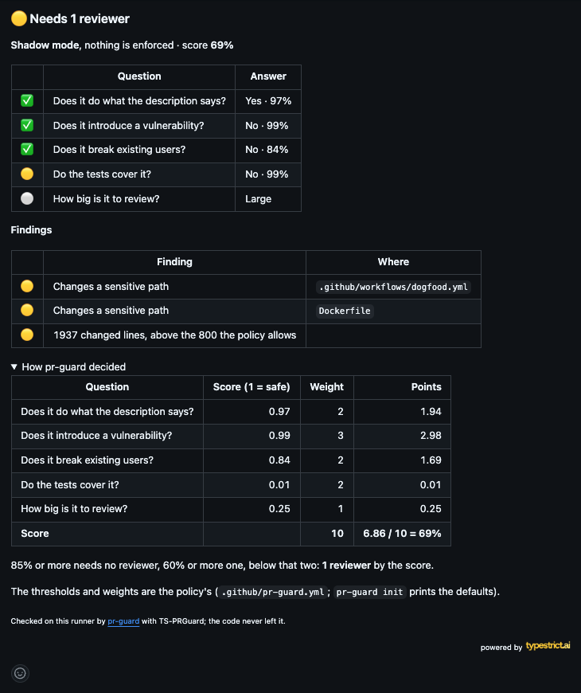
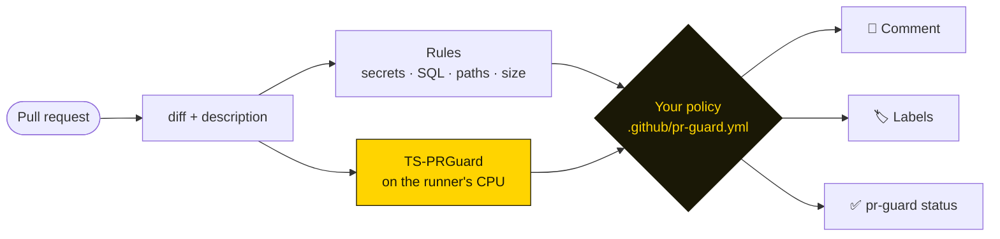

<p align="center">
  <a href="https://huggingface.co/typestrict/TS-PRGuard"></a>
</p>

<h1 align="center">pr-guard</h1>

<p align="center">
  <b>How many people should review this pull request?</b><br>
  A small model reads the diff on your own runner and answers, under a policy you write.
</p>

<p align="center">
  <a href="https://docs.typestrict.ai/en/pr-guard"></a>
  <a href="https://huggingface.co/typestrict/TS-PRGuard"></a>
  <a href="https://huggingface.co/typestrict/TS-PRGuard"></a>
  
  
  <a href="LICENSE"></a>
  <a href="https://typestrict.ai"></a>
</p>

---

pr-guard reads the diff and the description of a pull request, asks [TS-PRGuard](https://huggingface.co/typestrict/TS-PRGuard)
(150M parameters, 8-bit ONNX) five questions about it, adds deterministic checks for secrets, destructive SQL and
sensitive paths, and lets a YAML policy decide: **no reviewer, one or two, or blocked**. It comments on the pull
request, labels it and sets one status you can make required.

- **Private by design.** No API, no key, no telemetry: the model runs on the CI runner and the code never leaves it.
- **A cost that follows the change, with a ceiling.** On a stock `ubuntu-latest`, 11 seconds and 460 MB on a 48-line
  pull request (first model download included), 23 to 71 seconds and 1.9 GB from 382 to 1,937 changed lines. Each
  question reads at most 5,000 characters of the diff (14,000 for breaking change, up to 4,096 tokens), so memory stops
  growing once the diff fills that window. No inference service to wait on.
- **Everywhere your code is.** GitHub, GitLab and Bitbucket; GitHub Actions, GitLab CI, Bitbucket Pipelines, CircleCI,
  Bitrise, Jenkins, pre-commit, or any shell.
- **Your model if you want.** Train one on your own pull requests with [typestrict.ai](https://typestrict.ai) and point
  the policy at it.

<p align="center"></p>

## Quick start

```yaml
# .github/workflows/pr-guard.yml
on: pull_request
permissions:
  contents: read
  pull-requests: write   # the comment and labels
  statuses: write        # the pr-guard status
jobs:
  pr-guard:
    runs-on: ubuntu-latest
    steps:
      - uses: actions/checkout@v4
        with: { fetch-depth: 0 }
      - uses: typestrict-lab/pr-guard@v1
```

`@v1` is the action's major version and follows its fixes; the binary it installs is v0.1.0. In production, pin the commit it points to instead, so the action cannot change
under you: `uses: typestrict-lab/pr-guard@e6e89c7dd5a5d5df52cf07f1249fc0cbd9ae3f41 # v1`.

It starts in **shadow mode**: it reports on every pull request and never fails one. When its answers look right on your
code, write `mode: enforce` in `.github/pr-guard.yml` and make `pr-guard` a required status.

On a laptop:

```sh
curl -fsSL https://raw.githubusercontent.com/typestrict-lab/pr-guard/main/install.sh | sh
pr-guard check                     # this branch against its merge base
pr-guard check --staged --no-model # the staged changes, rules only, instant
```

## How it decides



| The model is asked | Default in the policy |
|---|---|
| Does it do what the description says? | warns above 40% that it does not, blocks above 70% |
| Does it introduce a vulnerability? | warns above 70% |
| Does it break existing users? | warns above 50% |
| Do the tests cover it? | warns above 50% that they do not |
| How big is it to review? | warns when very large |

The answers weigh into a score; 85% or more needs no reviewer, 60% or more one, below that two. The comment shows the
arithmetic for each pull request.

No reviewer is not a merge: the policy asks for no extra human approval. pr-guard comments, labels and sets a status, and
never merges; `auto_merge: true` only adds the `pr-guard:auto-merge` label for your own automation.

## The policy

```yaml
mode: shadow            # or enforce
model: pr-guard:1       # pr-guard:latest, hf:you/your-model, https://cdn…, or a directory

reviewers: { none: 85%, one: 60% }

questions:
  vulnerability: { weight: 3, warn: 70%, block: 90% }

rules:
  secrets: block
  sensitive_paths: { level: warn, paths: [infra/**, "**/auth/**"] }
```

Every key is optional. `pr-guard init` prints the whole default, commented; [docs/policy.md](docs/policy.md) explains
each key and how to choose the model.

## Limitations

- **Languages.** TS-PRGuard v1 was trained and evaluated on pull requests described in English, with code in
  JavaScript, TypeScript, Python, Go, Rust, Java, Kotlin, Swift, Dart, PHP and Ruby (`languages` in the policy). Code
  in any other language is "not evaluated": at least one reviewer, never auto-merge. The vulnerability question has
  almost no held-out examples in Kotlin, Swift and Dart.
- **Vulnerability.** Its held-out set is real security fixes, each once as the fix and once reversed, so half of it
  (299 of 597) introduces a vulnerability. There a warning from 70% is 90% precise, catches 91% of the vulnerable
  changes, fires on 9.7% of the safe ones and misses 8.7%. Real pull requests are rarely vulnerable: on the 38 pull
  requests in [examples/](examples) the warning went off on 4 of the 28 clean changes and caught 5 of the 10 planted
  vulnerabilities. That is why it only warns by default.
- **How it was measured.** The held-out set was split by repository (about one in ten of 8,355, never on both sides),
  but those are public projects, not yours. On breaking changes Jev is ahead (macro-F1 0.870 against 0.910). Run it in
  shadow mode on your own pull requests before you enforce it.

## Security of the workflow

- **Token.** The quick start asks only for `contents: read`, `pull-requests: write` (comment and labels) and
  `statuses: write`. `upload-sarif: "true"` also sends the findings to code scanning, and needs `security-events: write`.
  The action never runs code from the pull request: it reads the diff the checkout brought.
- **Forks.** On pull requests from forks GitHub gives the workflow a read-only token, so the comment, labels and status
  may not be written. pr-guard does not fail on that: the verdict is printed and in the job summary. A required
  `pr-guard` status will then be missing on those pull requests. Keep `on: pull_request`; do not move to
  `pull_request_target` to get a write token for forks.
- **Self-hosted runners.** The runner needs to reach Hugging Face once per model, or a mirror
  (`$PR_GUARD_HF_ENDPOINT`), a URL or a directory, or use the Docker image, which ships with the model. Every file is
  checked against its SHA-256. Avoid running pull requests from forks on self-hosted runners of a public repository.

## Learn more

| | |
|---|---|
| [Documentation](https://docs.typestrict.ai/en/pr-guard) | the PR Guard guide on docs.typestrict.ai, in English, [Portuguese](https://docs.typestrict.ai/br/pr-guard) and [Spanish](https://docs.typestrict.ai/es/pr-guard) |
| [Launch post](https://typestrict.ai/blog/pr-guard) | why we built it, what it measures against Jev and its limits |
| [Policy and model](docs/policy.md) | the file, how a verdict is made, `pr-guard:1`, `latest`, your own Hugging Face repo or a CDN |
| [Install and CI](docs/ci.md) | install script, Homebrew, Docker, the GitHub Action, pre-commit, GitLab, Bitbucket, CircleCI, Bitrise, Jenkins, output formats |
| [Publishing to the host](docs/hosts.md) | the comment, labels and status on GitHub, GitLab and Bitbucket, tokens, required reviewers |
| [Development](docs/development.md) | examples, tests, releases, how ONNX Runtime is linked |
| [TS-PRGuard on Hugging Face](https://huggingface.co/typestrict/TS-PRGuard) | the model card: questions, results against Jev, training data |

## License

Apache-2.0. TS-PRGuard is Apache-2.0 too.

<p align="right">
  <sub>powered by</sub>&nbsp;<a href="https://typestrict.ai"><picture><source media="(prefers-color-scheme: dark)" srcset="https://typestrict.ai/status/logo-dark.png"></picture></a>
</p>
